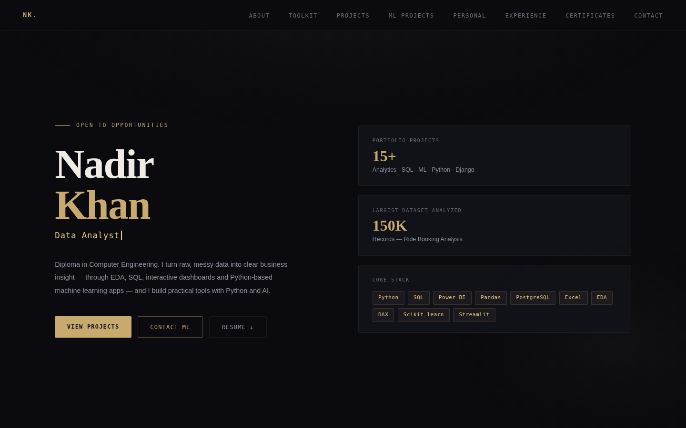
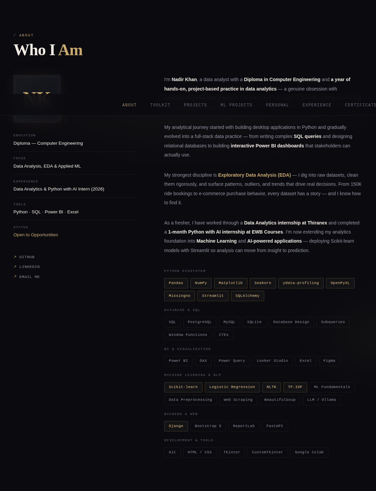
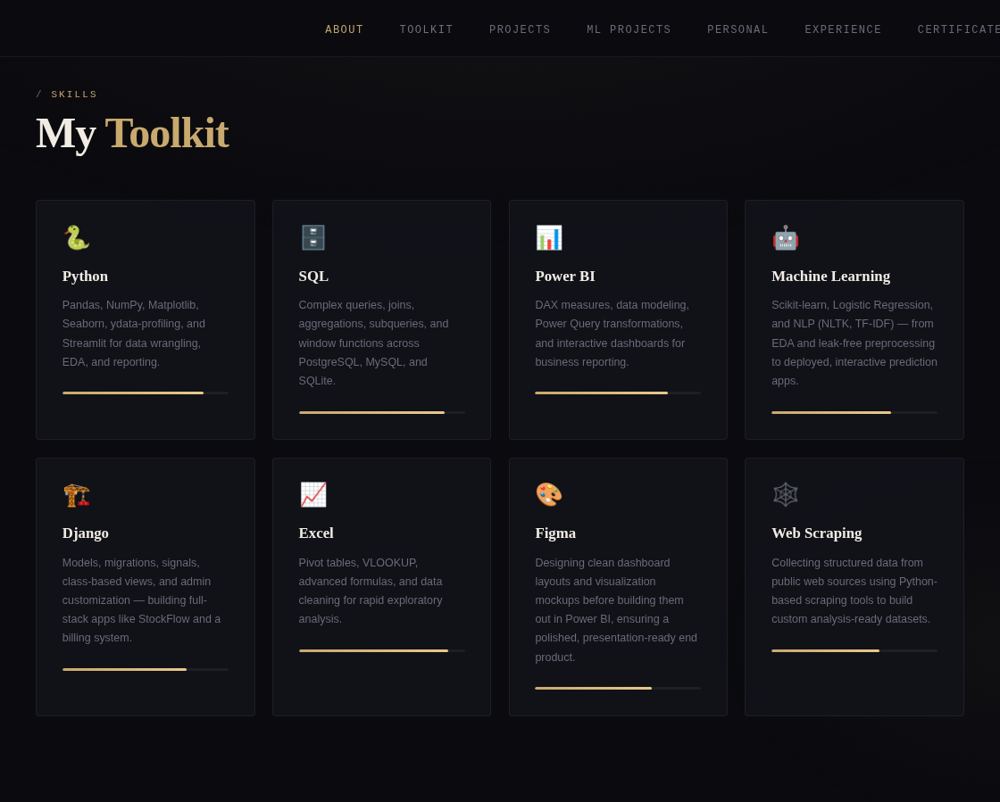
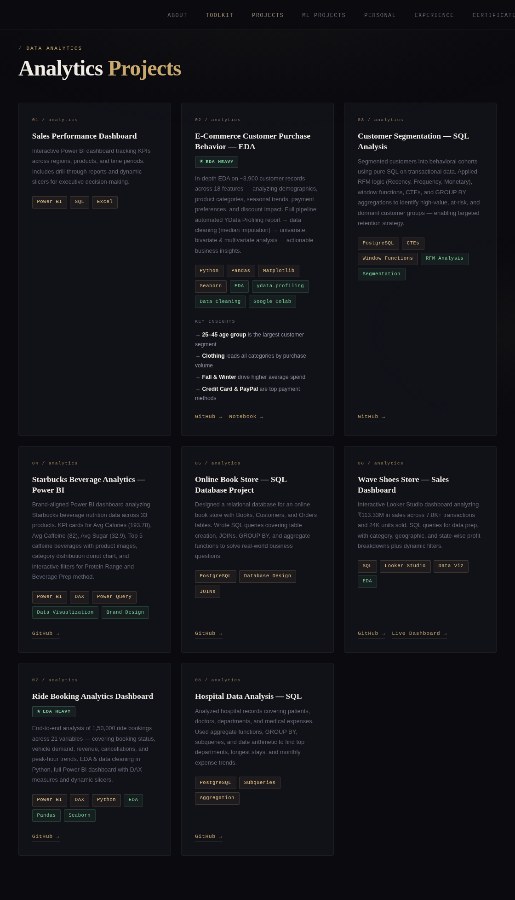
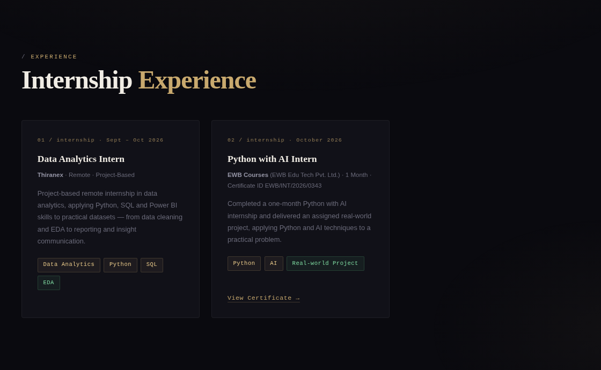
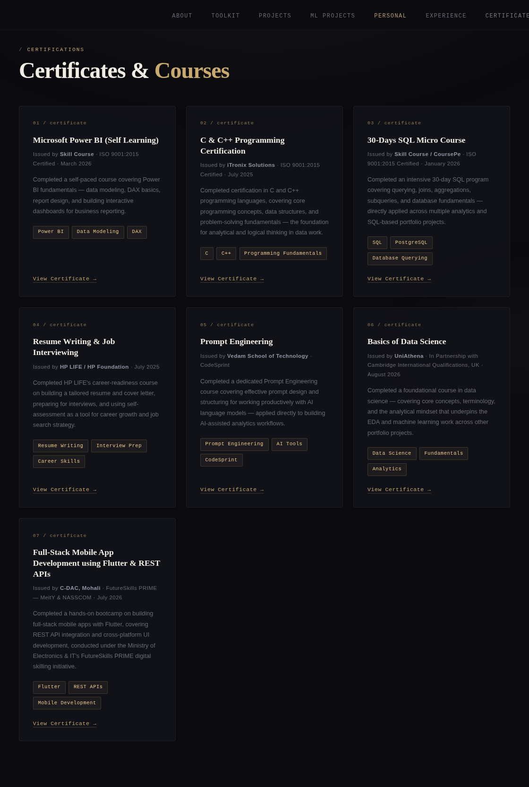
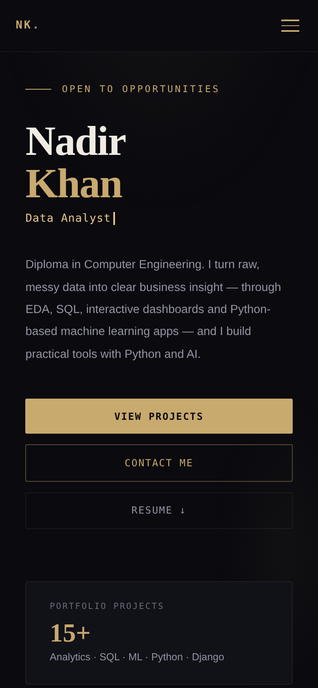

<div align="center">

# Nadir Khan — Portfolio

**Data Analyst · Python Developer · Aspiring ML Engineer**

A responsive single-page portfolio showcasing analytics, SQL, Power BI, machine learning and Python projects, with internship experience and verifiable certificates.

[](https://nadir789259.github.io/)
[](https://github.com/NADIR789259)
[](https://www.linkedin.com/in/nadirkhan-dataanalyst)



</div>

---

## Table of Contents

- [Overview](#overview)
- [Site Walkthrough](#site-walkthrough)
- [Featured Work](#featured-work)
- [Experience](#experience)
- [Tech Stack](#tech-stack)
- [Features](#features)
- [Project Structure](#project-structure)
- [Run Locally](#run-locally)
- [Contact](#contact)

---

## Overview

I am a Diploma in Computer Engineering student and fresher Data Analyst. This portfolio brings my work together in one place: exploratory data analysis, SQL databases, Power BI and Looker Studio dashboards, deployed machine learning apps, and full-stack Python builds. It also documents my internship experience and certifications.

**Live site:** https://nadir789259.github.io/

---

## Site Walkthrough

### About
Background, education, focus areas and categorized skills.



### Toolkit
Proficiency overview across Python, SQL, Power BI, Excel and more.



### Projects
EDA, SQL and BI dashboard projects, followed by deployed ML apps and personal builds.



### Experience
Internships in Data Analytics and Python with AI.



### Certificates
Course and training certificates with an in-page preview.



### Mobile View
Fully responsive layout with a mobile navigation menu.

<p align="center">
  
</p>

---

## Featured Work

| Category | Project | Highlights |
|---|---|---|
| Analytics | E-Commerce Customer Purchase Behavior | EDA on ~3,900 records, 18 features |
| Analytics | Ride Booking Analytics Dashboard | 150K bookings, Python + Power BI |
| Analytics | Customer Segmentation (SQL) | RFM analysis, CTEs, window functions |
| Analytics | Starbucks Beverage Analytics | Branded Power BI dashboard |
| Analytics | Wave Shoes Sales Dashboard | Looker Studio, ₹113.33M sales analyzed |
| Analytics | Online Book Store, Hospital Data Analysis | PostgreSQL database projects |
| Machine Learning | [Customer Churn Prediction](https://ml-customer-churn.streamlit.app/) | Scikit-learn, Streamlit, class-wise evaluation |
| Machine Learning | [Fake News Detection AI](https://fake-news-detector-nadir.streamlit.app/) | NLP, TF-IDF, Logistic Regression |
| Personal Build | [Dashboard Automation Tool](https://dashboard-automation-tool.streamlit.app/) | Streamlit, data cleaning and export pipeline |
| Personal Build | StockFlow, Billing System | Django applications |
| Personal Build | Student Result Management, Library Management | Python desktop apps with SQLite |

---

## Experience

| Role | Organization | Period |
|---|---|---|
| Python with AI Intern | EWB Courses (Certificate ID `EWB/INT/2026/0343`) | October 2026 |
| Data Analytics Intern | Thiranex (remote, project-based) | September – October 2026 |

---

## Tech Stack

| Area | Tools |
|---|---|
| Portfolio site | HTML5, CSS3, vanilla JavaScript (no build step) |
| Hosting | GitHub Pages |
| Contact form | FormSubmit |
| Analytics | Google Analytics 4 |
| Skills showcased | Python, Pandas, NumPy, Scikit-learn, Streamlit, Django, SQL, PostgreSQL, Power BI, DAX, Looker Studio, Excel, Git |

---

## Features

- Responsive layout with mobile navigation
- Scroll-reveal animations and animated role headline
- Certificate preview modal
- Working contact form with success and error states
- Downloadable resume
- SEO meta tags, Open Graph tags and custom favicon

---

## Project Structure

```
NADIR789259.github.io/
├── index.html                  # Markup, styles and scripts
├── README.md
└── assets/
    ├── favicon.svg
    ├── resume/
    │   └── Nadir_Khan_Resume.pdf
    ├── certificates/           # Images used by the preview modal
    └── screenshots/            # Images used in this README
        ├── hero.png
        ├── about.png
        ├── toolkit.png
        ├── projects.png
        ├── experience.png
        ├── certificates.png
        └── mobile.png
```

---

## Run Locally

```bash
git clone https://github.com/NADIR789259/NADIR789259.github.io.git
cd NADIR789259.github.io
python -m http.server 8000
```

Then open `http://localhost:8000` in a browser.

---

## Contact

- **Email:** nadirkhan5864@gmail.com
- **LinkedIn:** [nadirkhan-dataanalyst](https://www.linkedin.com/in/nadirkhan-dataanalyst)
- **GitHub:** [NADIR789259](https://github.com/NADIR789259)

Open to internships, junior roles and freelance data projects.

---

<div align="center">

© 2026 Nadir Khan

</div>